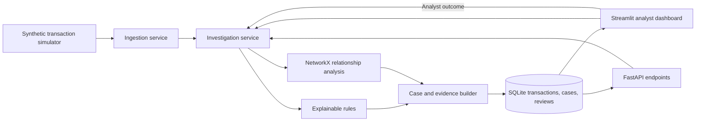

# Trace — Self-Directed Fraud Investigation Platform

> Task 1 copy: this documentation is assigned for review/editing. Run the application from C:\Me\CODOWEEN_FINANCE_PROJECT, where the complete source tree lives.


Trace monitors **synthetic** transactions, connects explainable risk signals into investigation dossiers, and lets analysts record outcomes. An unusual pattern is a lead for review, not proof of fraud.

## Problem and users

Financial investigators need to connect activity across accounts and review the evidence behind alerts. Trace demonstrates how a small fraud operations team can move from transaction monitoring to a documented analyst decision without automatically labeling unusual activity as fraud.

## Features

- Synthetic transaction replay and optional live demo feed.
- Transparent rules for rapid onward transfers, shared devices, transaction cycles, high velocity, repeated small transfers, and unusually large amounts.
- NetworkX relationship analysis and an account transfer graph.
- Investigation dossiers with signal explanations, transaction evidence, account activity context, priority, and status.
- Analyst outcomes: confirmed fraud, legitimate activity, or inconclusive.
- A bounded feedback adjustment for future cases with the same signal signature. Similar alerts remain visible; inconclusive outcomes do not affect priority.
- Streamlit dashboard and FastAPI endpoints backed by the same SQLite database.
- Compact top navigation separates Overview, Alerts, Cases, Network, Learning, and Accounts into focused workspaces instead of one long dashboard.

## Architecture



See [docs/architecture.md](docs/architecture.md) for component responsibilities and data flow, and [docs/decisions.md](docs/decisions.md) for key MVP tradeoffs.

See [docs/team-task-breakdown.md](docs/team-task-breakdown.md) for a four-part work split, file ownership, security and Git checklist, and suggested hackathon schedule.

Open [task pack index](../README.md) for separate handoff folders and task briefs.

## Project layout

```text
.
├── app.py
├── src/
│   ├── api/
│   └── fraud_investigator/
├── tests/
├── docs/
├── scripts/
├── .env.example
├── .gitignore
└── requirements.txt
```

## Run locally

```powershell
py -m venv .venv
.venv\Scripts\Activate.ps1
pip install -r requirements.txt
streamlit run app.py
```

The dashboard seeds ordinary activity and an A → B → C → A scenario with a shared device the first time it starts. Use **Replay suspicious scenario** to add another sequence, **Reset demo data** to restore the sample, or enable **Live monitoring** to add benign synthetic activity every three seconds.

Start the API in a second terminal:

```powershell
.venv\Scripts\Activate.ps1
uvicorn api.main:app --app-dir src --reload
```

API docs: `http://127.0.0.1:8000/docs`.

To use a different SQLite file, copy `.env.example` as a reference and set `FRAUD_DB_PATH` in each process environment. The app does not load `.env` files automatically.

## Tests

Run the standard-library unit tests with:

```powershell
py -m unittest discover -s tests -v
```

The optional `scripts/pre_submit.ps1` runs these tests, checks whitespace in tracked changes, and prints repository status.

## API routes

- `GET /health`
- `GET /transactions`
- `POST /transactions`
- `GET /cases?status=open`
- `GET /cases/{case_id}`
- `POST /cases/{case_id}/review`
- `POST /demo/transaction`
- `POST /demo/replay`
- `POST /demo/reset`

## Demo walkthrough

1. Open the dashboard and point out the synthetic feed and open investigation.
2. Show the transfer graph and the case's cycle, shared-device, and rapid-onward-transfer signals.
3. Review timestamps, amounts, account context, and supporting transactions.
4. Mark the case legitimate or inconclusive and explain that the analyst owns the final decision.
5. Replay the scenario and show how a reviewed matching pattern can modestly adjust priority while remaining visible.

See [docs/demo-script.md](docs/demo-script.md) for a short presenter script.

## Team contributions

Before submission, complete this table with each teammate's real GitHub username and the feature or documentation they personally contributed. Each participant must be added as a repository collaborator and make at least one genuine, meaningful commit from their own account. Do not create placeholder or token commits.

| Teammate | GitHub username | Contribution |
| --- | --- | --- |
| Complete before submission |  |  |

## Submission checklist

- Confirm the designated GitHub repository, visibility, official closing time and time zone, and required submission format with the organizers.
- Confirm every teammate is a collaborator and has a genuine contribution in the repository history.
- Review `git status` and `git diff`; run the relevant tests.
- Commit focused changes with descriptive messages and push before the official deadline.
- Check that no secrets, credentials, real customer data, or generated database files are included.
- Add a screenshot or short demo video and submit the required repository URL/form.

The official repository URL, deadline, and submission form were not included in the rules PDF; fill these from the organizers' instructions before publishing.

## Known limitations

- Rules are deterministic demo heuristics, not a trained model or production fraud decision system.
- Account age is optional transaction metadata for the sample.
- Feedback matches an exact set of signal codes and changes priority by at most 10 points; it does not suppress alerts or autonomously decide outcomes.
- The database is a local SQLite file. No bank, payment processor, or real customer data is connected.
- The demo has no user authentication or access controls and is intended to run locally with synthetic data only.


