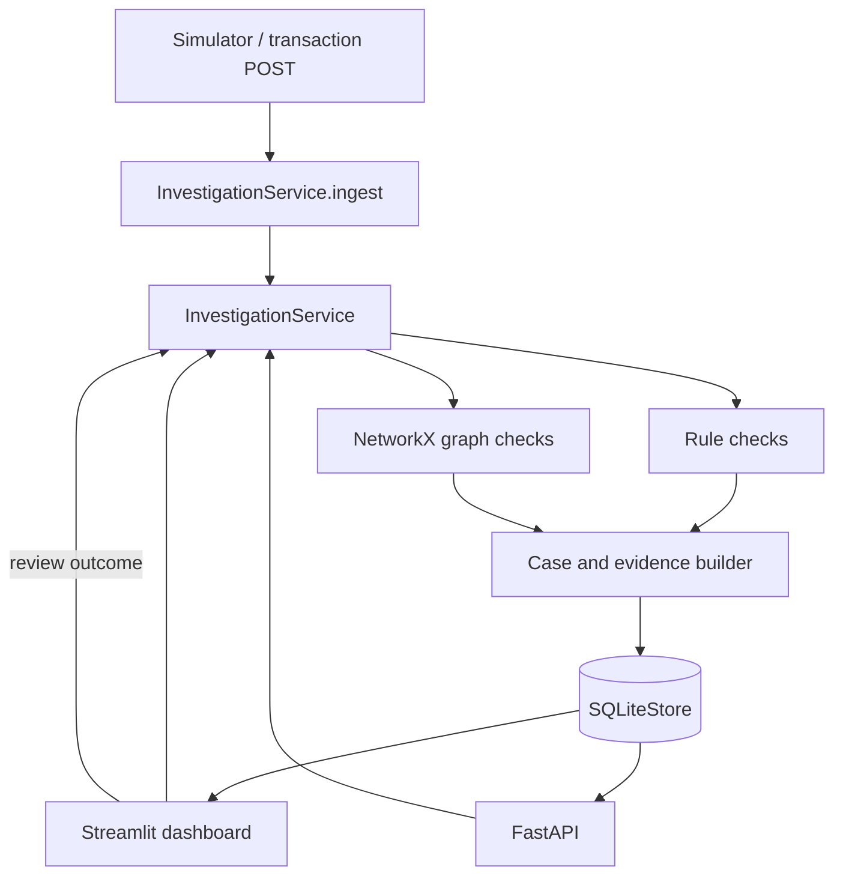

# Architecture

## Components

- `src/fraud_investigator/models.py` defines validated Pydantic transaction, signal, case, and review models.
- `src/fraud_investigator/simulator.py` creates repeatable, synthetic normal activity and an illustrative linked-account scenario.
- `src/fraud_investigator/service.py` owns ingestion, rule checks, case grouping, evidence assembly, and conservative feedback.
- `src/fraud_investigator/graph_analysis.py` uses NetworkX to find short-cycle and rapid-onward-transfer clues and builds graph snippets for the dossier.
- `src/fraud_investigator/storage.py` persists transactions, cases, and reviewed outcomes to SQLite.
- `src/api/main.py` exposes the service through FastAPI. `app.py` presents the analyst workflow with Streamlit.

## Data flow

1. A synthetic transaction enters the shared service from the UI, the simulator, or `POST /transactions`.
2. The service examines recent history before storing the new event and records any explainable signals.
3. Related signals update an open case or create a new one. The service gathers connected transactions, account activity summaries, and a graph snippet into its evidence dossier.
4. The analyst records an outcome. Confirmed and legitimate outcomes are stored by exact signal signature; future matching cases receive a small capped priority adjustment and remain reviewable.

## Runtime

Run Streamlit from the project root with `streamlit run app.py`. Run the API with `uvicorn api.main:app --app-dir src --reload`. Both processes use `data/fraud_platform.sqlite3` by default. Set the same `FRAUD_DB_PATH` in both processes when using a custom location.
